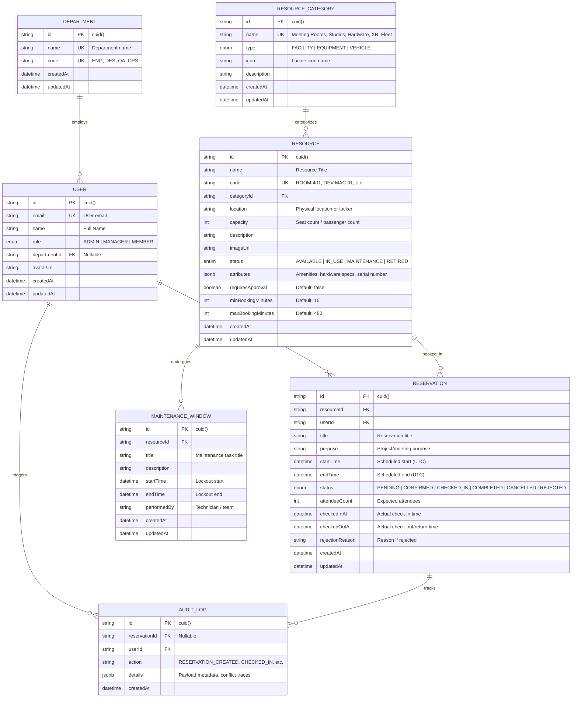

# AssetFlow - Entity Relationship (ER) Diagram & Data Architecture

## Overview
This document provides the complete Entity Relationship (ER) Diagram and schema specification for **AssetFlow**, a high-concurrency Resource Reservation Management System developed for PrimeWave Lab.

---

## 1. Visual Entity Relationship Diagram (Mermaid)

---

## 2. Relational Integrity & Engineering Decisions

1. **Conflict Query Optimization:**
   - Compound B-Tree Index on `reservations(resourceId, startTime, endTime)` allows index-only range scans when evaluating the conflict condition:
     $$\text{Overlap: } (\text{NewStart} < \text{ExistingEnd}) \land (\text{NewEnd} > \text{ExistingStart})$$
   - Excludes terminal states (`CANCELLED`, `REJECTED`) from conflict evaluation.

2. **Maintenance Lockout Isolation:**
   - Compound index on `maintenance_windows(resourceId, startTime, endTime)` prevents scheduling during operational servicing.

3. **Lifecycle Tracking & Auditability:**
   - `checkedInAt` and `checkedOutAt` distinguish planned reservation duration from actual operational utilization.
   - Every status mutation is recorded in `audit_logs` for non-repudiation and enterprise governance.
